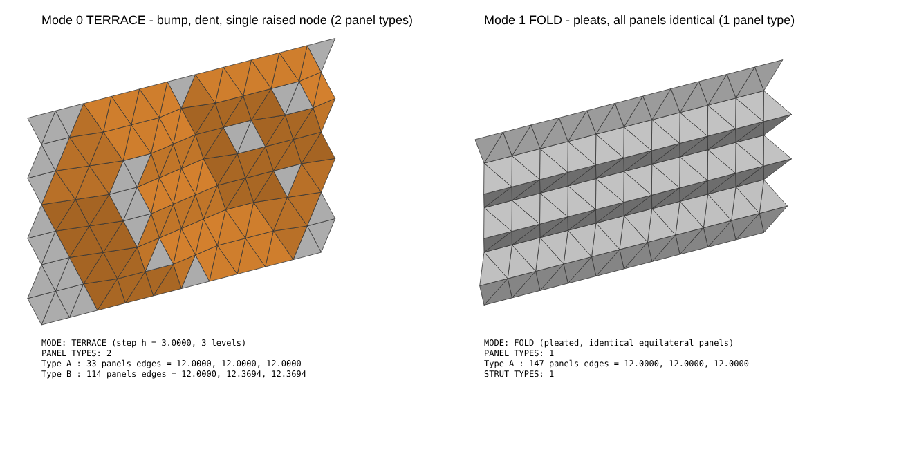

# TriFacade — identical-module triangulated façade (Rhino 8 + Grasshopper)



*Left: Mode 0 "Terrace", with a bump, a dent and one raised node, using 2 panel types.
Right: Mode 1 "Fold", with pleated bands where every panel is identical.
The image is drawn from the same code that runs inside Grasshopper.*

Files in this folder:

| File | What it is |
|---|---|
| `TriFacade.py` | The script. Paste it into one Grasshopper **Python 3 Script** component. |
| `SETUP_GUIDE.md` | This guide. |
| `test_trifacade.py` | Automated checks of the geometry (run `python3 test_trifacade.py`, no Rhino needed). |
| `make_preview.py` | Rebuilds `preview.png` / `preview.svg`. |

---

## 1. The key fact behind the design (read this first)

**You cannot get a smooth local bump out of identical equilateral triangles that stay
connected.**

On a flat grid of equilateral triangles, every interior node is surrounded by
six 60° corners, which add up to exactly 360°. If every edge keeps its length, every
triangle keeps its 60° corners, so the total around each node stays 360°. A surface
whose corners always add up to 360° is "flat" in the mathematical sense (zero
Gaussian curvature). It can **fold** along straight lines, like paper or rigid origami,
but it can never form a dome or a dish, the same way a sheet of paper cannot wrap a
ball without creasing. This is Gauss's *Theorema Egregium* applied to a triangle grid.

What this means for the three options you listed:

| Option | What actually happens | Verdict |
|---|---|---|
| **A. Kangaroo with equal-length goals** | The solver must trade "equal edges" against "push here". It always settles on a compromise, so every panel ends up slightly different, typically 300+ unique triangles on a real façade. | Good for studies, but **not** a 1–3 panel-type system |
| **B. Equal-member space frame / geodesic** | A geodesic dome with all members equal only works for the few Platonic shapes, and a free-form façade bump can't be one. Same limit as A. | Not achievable as asked |
| **C. Quantised node heights (Terrace) or rigid folding (Fold)** | Gives *exactly* 2 panel types (Terrace) or *exactly* 1 (Fold), with zero length error | **Recommended. This is what the script does.** |

### Mode 0: TERRACE (recommended for local push/pull, 2 panel types)

* The grid stays a perfect equilateral grid **in elevation**: nodes are never moved
  sideways.
* Nodes move only along the surface normal, and only in **fixed steps of height `h`**
  (`h = Depth ÷ Levels`).
* Neighbouring nodes may differ by **at most one step**.

With these rules every possible triangle is one of only two shapes:

| Panel | Nodes | Edges | Note |
|---|---|---|---|
| **Type A** | all on the same level | L, L, L | equilateral |
| **Type B** | on two neighbouring levels | L, S, S where S = √(L² + h²) | isosceles. A triangle with one node up and one with two nodes up are the **same** congruent panel (one is just rotated) |

You get exactly **2 panel types** and **2 strut lengths** (L and S), whatever
attractors, curves or nodes you use. All of the variation goes into the node
(connection) geometry, which is what you asked for.

Example with L = 12'-0" and h = 3'-0": S = 12.369' (12'-4 7/16"). If 12'-0" is a hard
maximum for *every* edge, set `Size` = √(12² − h²), e.g. 11.619' for h = 3'.

### Mode 1: FOLD (1 panel type)

The grid hinges along its horizontal lattice lines. Strips fold out and back in
pairs, forming pleats. **Every panel is the identical equilateral triangle and every strut
is length L.** The only things that change are the hinge angles. Depth is organised
in horizontal bands instead of isolated bumps (that is the price of 1 panel type), and
the façade gets slightly shorter vertically as it folds. The brief allows this, since
the boundary may shift. The attractors decide *which bands* fold and *how deep*.

> Tip: if you want the pleats to run vertically instead of horizontally, set `Angle` = 90.

---

## 2. Build the definition (about 10 minutes)

### Step 1: Create the script component

1. In Grasshopper, double-click an empty part of the canvas, type **`Python 3 Script`**
   and press Enter. (In Rhino 8 it's under **Maths ▸ Script**.)
2. Double-click the component to open the editor, **delete the sample text**, paste the
   full contents of `TriFacade.py`, then press **OK / Save**.

### Step 2: Create the inputs

Zoom in on the component until small **⊕ / ⊖** signs appear on its left side. Click
⊕ to add inputs, then **right-click each input ▸ rename it** exactly as below (names are
case-sensitive). Then **right-click ▸ Type hint** and, for list inputs, **right-click ▸
List Access**.

> You only *need* `Srf`. Any input you don't create uses its default, so you can start
> with just `Srf` and add the others later.

| # | Input name | Type hint | Access | Default | What it does |
|---|---|---|---|---|---|
| 1 | `Srf` | Brep | Item | (required) | The flat façade surface. Trimmed surfaces and surfaces with window holes are fine. |
| 2 | `Size` | float | Item | 12 ft (auto-converted to your model units) | Panel edge length **L** |
| 3 | `Mode` | int | Item | 0 | 0 = Terrace (2 types), 1 = Fold (1 type) |
| 4 | `Trim` | int | Item | 1 | How the grid meets the boundary: 0 = only whole panels inside, 1 = panel centre inside (best fit), 2 = cover everything (panels overhang) |
| 5 | `Angle` | float | Item | 0 | Rotates the grid (degrees). 90 turns rows vertical. |
| 6 | `ShiftU` | float | Item | 0 | Slides the grid sideways (0–1 = one panel width) to get a nicer edge |
| 7 | `ShiftV` | float | Item | 0 | Slides the grid up/down (0–1 = one row) |
| 8 | `Pts` | Point3d | **List** | none | Attractor points |
| 9 | `PtW` | float | **List** | 1 | Strength per point: **+1 push out, −1 pull in**, 0.5 = half depth. One value applies to all. |
| 10 | `Crvs` | Curve | **List** | none | Control curves (depth follows the curve) |
| 11 | `CrvW` | float | **List** | 1 | Strength per curve (± like `PtW`) |
| 12 | `Nodes` | Point3d | **List** | none | Hand-picked grid nodes. Each one snaps to the nearest node and is raised to full depth × weight. |
| 13 | `NodeW` | float | **List** | 1 | Strength per node (±) |
| 14 | `Radius` | float | Item | 3 × Size | How far an attractor or curve reaches |
| 15 | `Depth` | float | Item | 0.25 × Size | Maximum displacement. A negative value flips push/pull. |
| 16 | `Levels` | int | Item | 2 | Terrace: number of height steps (h = Depth ÷ Levels). Fold: number of standard hinge angles. |
| 17 | `Spread` | bool | Item | True | True = keep full depth and widen the slopes around it. False = keep the footprint and lower the peak. |
| 18 | `PinEdge` | bool | Item | True | Keep the façade perimeter and window edges flat (Terrace) |
| 19 | `Bake` | bool | Item | False | Writes the result into Rhino when True |

### Step 3: Create the outputs

Click ⊕ on the **right** side of the component and rename the outputs:

| Output | What it gives you |
|---|---|
| `Mesh` | The whole façade as one welded mesh (good for analysis or Kangaroo) |
| `Panels` | One planar triangular surface per panel |
| `PanelType` | Panel type number per panel (0 = A, 1 = B …) |
| `Colors` | A colour per panel by type, for preview |
| `Struts` | One line per edge / structural member |
| `StrutType` | Strut length type per line (0 = shortest) |
| `Joints` | Node points |
| `JointType` | Node configuration number (identical numbers = identical connector) |
| `JointLevel` | Terrace level of each node (0 = flat) |
| `Frame` | The plane the grid was built on |
| `Report` | A text summary: panel types, strut lengths, node count, depth, length error |

### Step 4: Connect the controls (all native components)

| Native component (where to find it) | Settings | Connect to |
|---|---|---|
| **Surface** param (Params ▸ Geometry) | right-click ▸ *Set one Surface* ▸ pick your façade | `Srf` |
| **Number Slider** (Params ▸ Input) | 6.000 – 14.000, value 12 (feet model) | `Size` |
| **Value List** (Params ▸ Input) | edit to two lines: `Terrace = 0` and `Fold = 1` | `Mode` |
| **Value List** | `Inside = 0`, `Centre = 1`, `Cover = 2` | `Trim` |
| **Number Slider** ×3 | Angle 0–90; ShiftU and ShiftV 0.00–1.00 | `Angle`, `ShiftU`, `ShiftV` |
| **Point** param (Params ▸ Geometry) | right-click ▸ *Set Multiple Points* ▸ click points in Rhino | `Pts` |
| **Panel** (Params ▸ Input) | type one value per line, e.g. `1` and `-1` | `PtW` |
| **Curve** param | right-click ▸ *Set Multiple Curves* | `Crvs` |
| **Number Slider** | −1.00 – 1.00 | `CrvW` |
| **Point** param | *Set Multiple Points*, using the **Point** snap on the previewed `Joints` | `Nodes` |
| **Number Slider** | −1.00 – 1.00 | `NodeW` |
| **Number Slider** | 0 – 60 | `Radius` |
| **Number Slider** | −6.00 – 6.00 | `Depth` |
| **Number Slider** (integer) | 1 – 6 | `Levels` |
| **Boolean Toggle** (Params ▸ Input) ×2 | True | `Spread`, `PinEdge` |
| **Button** (Params ▸ Input) | | `Bake` |

### Step 5: Preview and read the result

| Native component | Connect |
|---|---|
| **Custom Preview** (Display ▸ Preview) | `Panels` → **G**, `Colors` → **M** (A = grey, B = orange) |
| **Panel** | `Report` → Panel, to read the panel and strut schedule live |
| **Text Tag 3D** (Display ▸ Dimensions), optional | **Area** (Surface ▸ Analysis) on `Panels` → its **C** output to Location, `PanelType` → Text |

Turn off the preview of the script component itself (right-click ▸ *Preview* off)
so you only see the coloured panels.

### Step 6: Bake

**Option 1 (built into the script):** click the **Button** on `Bake`. It creates
these layers:

```
TriFacade
 ├─ Panels Type A      (planar surfaces, user text "PanelType" = A)
 ├─ Panels Type B
 ├─ Struts 1 / Struts 2 (lines, user text "StrutType")
 ├─ Joints             (points, user text "JointType")
 └─ Mesh
```

The user text travels into Rhino, so you can select or schedule by type
(`SelByUserText`, or Rhino 8 **Block / Object** tables).

**Option 2 (native):** right-click any output (for example `Panels`) ▸ **Bake…**, or
use Rhino 8's **Model Object / Bake** components (Rhino ▸ Output).

> Click the Button once. Each click bakes another copy.

---

## 3. What happens inside, step by step

| Step | What the script does | Why |
|---|---|---|
| **1. Input surface** | Reads the plane of `Srf`, its outer edge and any holes. Stops with an error if the surface is not flat. | Everything is built in that plane, so the façade can be at any orientation. |
| **2. Triangle size** | Builds a perfect equilateral grid of edge `Size`, starting at the lower-left corner of the surface, then applies `Angle` and `ShiftU/V`. Keeps triangles according to `Trim`. | The grid is never stretched to fit. The boundary adapts to the grid instead, as the brief allows. |
| **3. Displacement controls** | Each node gets an influence value from −1 to 1, from the nearest attractor point or curve with a smooth falloff over `Radius`. The strongest one wins, so push and pull zones can sit side by side. Picked `Nodes` are set exactly. | Covers attractors, curves, hand-picked nodes and adjustable depth. |
| **4. Equal-length constraints** | *Terrace:* influence becomes whole height steps (`round(influence × Levels)`). *Fold:* influence becomes a hinge angle per strip, optionally rounded to `Levels` standard angles. | Heights or angles are limited to values that can't change panel shapes. |
| **5. Relaxation** | *Terrace:* a graph relaxation repeats until **no two neighbouring nodes are more than one step apart** and edge nodes stay at 0 (if `PinEdge`). `Spread` decides whether slopes widen or peaks drop. *Fold:* strips are hinged one after another so each pleat closes back to zero depth. | This plays the role of Kangaroo, but it is exact: the constraint is met with zero error instead of being approximated. |
| **6. Final façade** | Converts back to Rhino geometry. Panels are grouped by measured edge lengths, struts by measured length, joints by their arrangement of neighbours. The `Report` lists all of it with the largest length error (about 1e-15, i.e. exact). | The schedule comes from the actual geometry, so you can trust the panel count. |
| **7. Bake** | Writes layers and user text. | Ready for documentation and fabrication. |

---

## 4. Optional: compare with Kangaroo (Option A)

To show the team why the exact approach is used, or to explore free-form shapes before
committing, plug the script outputs into Kangaroo 2 (installed with Rhino 8):

1. **Length (Line)** goal (Kangaroo2 tab ▸ Goals): `Struts` → *Line*, set *Length* to
   `Size`, *Strength* 100.
2. **Anchor** goal for the nodes that should stay put: **Equality** (Maths ▸ Operators)
   testing `JointLevel` = 0 → *Pattern* of a **Dispatch** (Sets ▸ List), `Joints` → *List*,
   Dispatch output **A** → Anchor *Point*, *Strength* 1000.
3. **Anchor** goal with a target: `Joints` moved by **Move** (Transform ▸ Euclidean)
   along `Frame`'s normal (**Deconstruct Plane** ▸ Z × your displacement) → *Target*,
   *Strength* 10.
4. Connect all three goals into the *GoalObjects* input of the **Solver** (Kangaroo2 ▸ Main;
   hold **Shift** while dragging to add several wires). Put a **Boolean Toggle** on *Reset*.
5. Rebuild the triangles from the solved points and measure them (**Explode**,
   **Length**, **Create Set**). You will see dozens to hundreds of distinct lengths.
   This is the geometric limit described in section 1, not a tuning problem.

---

## 5. Fabrication notes

* **Panels:** Terrace gives 2 types, A (equilateral) and B (isosceles L-S-S). Each
  type can be mirrored, but an equilateral or isosceles triangle is mirror-symmetric,
  so a flipped panel is the same part.
* **Struts:** 2 lengths (Terrace) or 1 (Fold).
* **Nodes:** `JointType` counts distinct node configurations. Inside a uniform area
  they repeat. Expect more variety around slope edges. To keep connector types down,
  use fewer `Levels` and larger `Radius` (gentler, more regular slopes), or use Fold
  mode, which repeats node types along each band.
* **Hinge angles:** Fold mode with `Levels` = 2–3 limits the façade to 2–3 standard
  hinge angles.
* **Depth vs. size:** a step `h` of about 0.2–0.3 × L (2'-6" to 3'-6" for 12' panels) reads
  clearly from the street and keeps panel B close to equilateral.

## 6. Troubleshooting

| Message / symptom | Fix |
|---|---|
| `ERROR: Connect a planar surface to Srf.` | Connect a surface to `Srf`, and check the input is named exactly `Srf`. |
| `ERROR: Srf must be planar.` | The surface is curved. Use a flat surface, for example from `PlanarSrf` in Rhino. |
| `No triangles fit` | Make `Size` smaller or set `Trim` = 2. |
| Bump doesn't reach full depth | It's too close to an edge or window while `PinEdge` is on (each row can climb only one step). Move it inward, use fewer `Levels`, or turn `PinEdge` off. |
| Only one attractor point works | `Pts` (and `PtW`) must be set to **List Access**. |
| Nothing moves | `Radius` too small, or `Depth` = 0. |
| Too many triangles cut at the edges | Try `Trim` = 0 or 2 and move the `ShiftU` / `ShiftV` sliders to find the best fit. |
